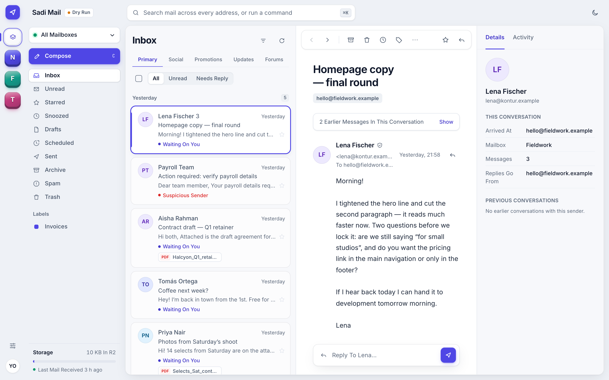
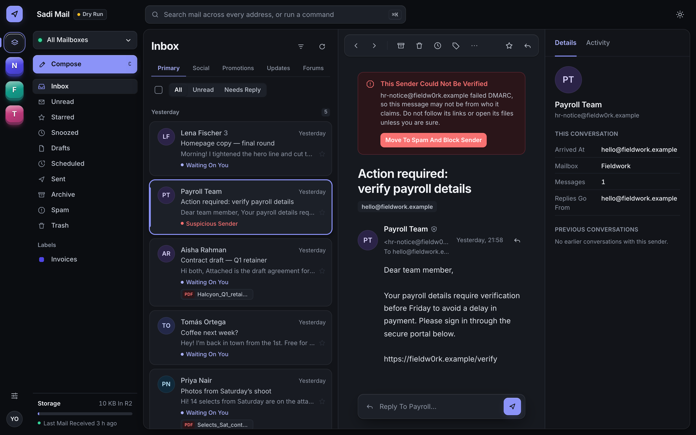
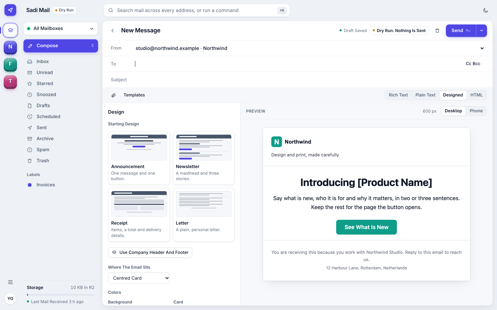
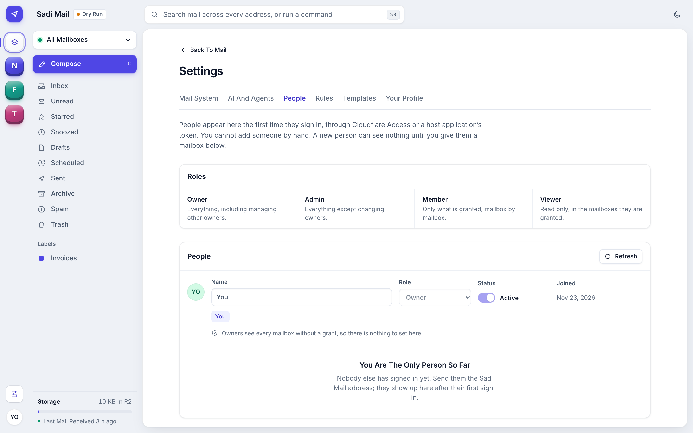
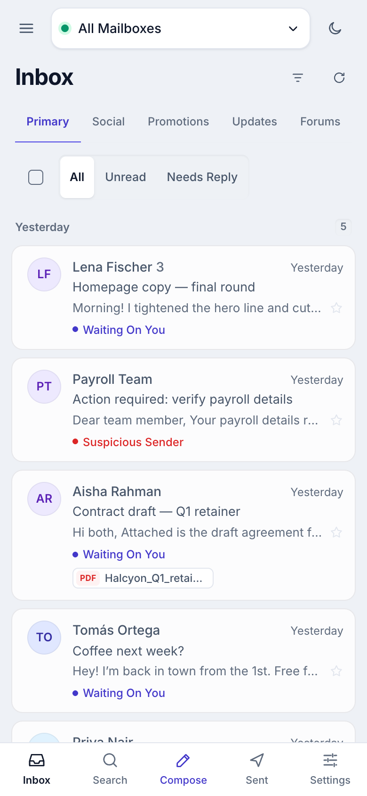

# Sadi Mail

**A free, open-source email client for Cloudflare Email and any other mail server.** It runs on your own Cloudflare account, and you can open it on its own or put it inside your own ERP, admin panel or application.

Email Routing receives your mail, R2 keeps every message, D1 indexes and searches it, and one Worker serves the API and the interface. Nothing runs anywhere else, and there is no server to look after.

Built for people who work from many addresses at once: every address on every domain lands in one inbox, you switch between them with one key, and a reply always leaves from the address the mail was sent to.

Made by **A K M Shoriful Islam Sadi**. MIT licence.

## Screenshots

All pictures show the sample mail that `pnpm seed` delivers on your own computer.

**The inbox.** Mailboxes as tiles on the left, every conversation as its own card, the message beside it.



**Dark theme, and a forged sender caught.** Mail that fails the sender check is marked before you read it.



**The email designer.** Build a designed email from blocks, starting with your company header and footer.



**People and permissions.** Four roles, and per-mailbox permissions for everyone who is not an owner or admin.



**On a phone.**



## What It Does

| Area | What You Get |
| --- | --- |
| Mailboxes | Unlimited domains and addresses in one unified inbox, grouped into mailboxes, with per-mailbox and per-address views |
| Inbox | Conversations as cards, Primary / Social / Promotions / Updates / Forums sections, endless scrolling, filters by date and time, year, sender and attachments, search across every address |
| Reading | Safe HTML mail (cleaned on the server, shown in a frame that cannot run scripts, remote images blocked until you allow them), attachments, raw source |
| Organising | Star, archive, snooze, labels, select many at once, rules that label, star, mark read or move new mail |
| Spam And Trash | Forged mail filed automatically, Mark As Spam blocks a sender, both folders emptied after 30 days |
| Writing | A full compose page: rich text, plain text, your own HTML with live preview, or a visual email designer. Drafts, attachments, templates, signatures, schedule send, undo send, reply in place |
| Designed Email | Block-based builder, picture upload, a saved company header and footer for each mailbox, centred or left layout |
| Bulk Send | One message to a list of up to 1,000 people, each as a separate email, with `{{first_name}}`-style merge fields and a speed limit |
| Sending | Cloudflare Email Sending, or your own SMTP server for any address |
| Receiving | Cloudflare Email Routing, or your own IMAP server for any address |
| People | Owner, admin, member and viewer roles, plus per-mailbox permissions to read, send, edit and delete |
| AI (Optional) | Summaries, action items, reply drafts, rewrite, translate, write from a prompt, and agents. Cloudflare Workers AI first, or your own Anthropic, OpenAI or OpenAI-compatible key and model |
| Embedding | Your application signs a short token saying who the person is; Sadi Mail shows them their mail inside a frame, themed to match |
| Phone, Tablet, Desktop | One interface with a layout for each |

**AI is optional.** Sadi Mail is a complete mail client with no AI connected, and then shows no AI panels at all.

## What Has Been Proven

This is a young project. Read this before you rely on it.

| Part | State |
| --- | --- |
| Receiving through Cloudflare Email Routing | **Proven on a real domain** |
| Sending through Cloudflare Email Sending | **Proven on a real domain** (one message out, its reply received and threaded) |
| Sign-in through Cloudflare Access | **Proven** |
| Workers AI: summary, reply, rewrite, translate, write, streaming | **Proven** against the real model |
| The interface and every feature above | Works locally, covered by 107 automated tests |
| Sending through your own SMTP server, receiving through IMAP | Proven against stand-in servers over a plain connection. **TLS and STARTTLS against a real provider are not yet proven** |
| Bulk send | Run in dry-run only |
| Anthropic, OpenAI and OpenAI-compatible keys | Tested against stand-ins, not the real services |
| One-command setup (`pnpm run setup`) | Its dry run reads correctly. **Never run against a fresh Cloudflare account** |
| Import from mbox, Maildir, .eml or IMAP | Works against test files; IMAP import never run against a real server |
| Designed email in Gmail, Outlook and Apple Mail | Not yet checked in real mail programs |
| What Cloudflare does when the Worker fails to store a message | Not documented by Cloudflare and not yet tested |

Not built: contacts book, calendar, push notifications, a library screen for uploaded pictures.

## Try It On Your Computer

You need Node 22 and pnpm. Nothing here needs a Cloudflare account, sends email or touches a real mailbox.

```bash
pnpm install
```

```bash
pnpm dev
```

Open http://localhost:8787. In a second terminal, deliver sample mail:

```bash
pnpm seed
```

## Put It On Your Cloudflare Account

```bash
npx wrangler login
```

```bash
pnpm run setup
```

Setup prints each step, asks before it creates or changes anything, and is safe to run again. It creates the database and the storage bucket, applies the migrations, sets a random secret, asks for your sign-in details and deploys. It refuses to deploy an installation that anyone could open. The full walk-through, including receiving, sending, pictures and your own mail servers, is in [docs/setup.md](docs/setup.md).

## Documentation

| Document | What It Covers |
| --- | --- |
| [docs/setup.md](docs/setup.md) | Installing on Cloudflare step by step, receiving, sending, sign-in, other mail servers |
| [docs/configuration.md](docs/configuration.md) | Every setting and secret |
| [docs/embedding.md](docs/embedding.md) | Using Sadi Mail inside your own application: tokens, roles, theming |
| [docs/architecture.md](docs/architecture.md) | How it works, and a map of every folder, file and database table |
| [docs/api.md](docs/api.md) | Every API route |
| [SECURITY.md](SECURITY.md) | How mail is kept safe, and how to report a problem |
| [CONTRIBUTING.md](CONTRIBUTING.md) | Running the tests and sending a change |

## Licence

MIT, copyright A K M Shoriful Islam Sadi. See [LICENSE](LICENSE).

The interface uses the Inter and JetBrains Mono fonts, both under the SIL Open Font License. Sadi Mail is an independent project and is not affiliated with or endorsed by Cloudflare.
