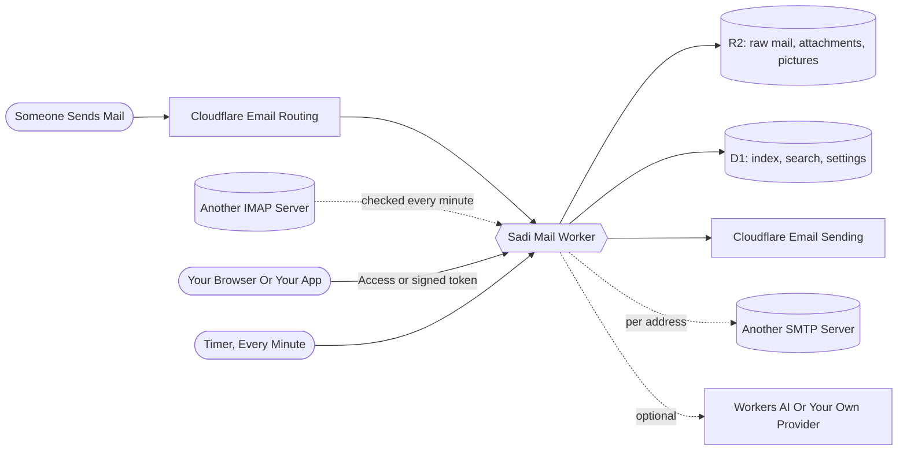

# How Sadi Mail Works

One Cloudflare Worker is the whole application. Every other part is a Cloudflare service bound to it.



## What Happens To A Message

**Arriving.** Email Routing hands the raw message to the Worker's `email()` handler. The Worker writes it to R2 first, then parses it and writes the index rows to D1: the conversation, the message, its attachments and its search entry. If the R2 write fails the handler throws, so the message is never reported as accepted. If indexing fails after the R2 write, a sweep every minute rebuilds the entry from R2. Mail fetched over IMAP goes through exactly the same path.

**Sorting.** Before it is stored, the message is checked for forgery (SPF and DMARC results from the receiving server), matched against senders you blocked, placed in an inbox section from its own headers, and run through your rules. None of this uses AI.

**Reading.** The browser asks the Worker's JSON API. Message HTML is cleaned on the server and shown in a frame that cannot run scripts.

**Sending.** A message is stored first, then handed to a transport: dry run, Cloudflare Email Sending, or the SMTP server set for that address. A copy of what was sent is kept in R2. Scheduled messages, undo-send and bulk sends all wait in D1 and are sent by the timer.

**AI.** If a provider is connected, mail is passed to the model as data inside a wrapper, with a standing rule not to follow instructions found in it. The model has no tools. Nothing it writes is sent: drafts and notes wait for a person.

## Map Of The Project

```
sadi-mail/
├── src/
│   ├── worker/        The Worker: API, mail in, mail out, timer jobs
│   ├── client/        The interface (React, plain CSS)
│   └── shared/        Types and pure logic used by both
├── migrations/        Database schema, applied in order
├── scripts/           Local development, setup, sample mail, import
├── test/              Automated tests (Vitest, in the Workers runtime)
├── docs/              This documentation
└── wrangler.jsonc     Cloudflare configuration
```

### `src/worker`

| File | What It Does |
| --- | --- |
| `index.ts` | Entry point: web requests, the `email()` handler, the timer |
| `api.ts` | Most API routes: conversations, search, send, addresses, people, AI, profile |
| `extras.ts` | Drafts, draft attachments, cancel send, labels, templates, contacts |
| `auth.ts` | Who is calling (host token, Cloudflare Access, local development) and what they may do |
| `ingest.ts` | Storing and indexing incoming mail; the repair sweep |
| `sanitize.ts` | Cleaning message HTML |
| `section.ts` | Choosing the inbox section from a message's headers |
| `rules.ts` | Rules that act on new mail |
| `send.ts` | Sending, scheduling, undo-send |
| `bulk.ts` | Bulk sends |
| `wire.ts`, `smtp.ts`, `imap.ts` | A small SMTP client and IMAP client over Cloudflare TCP sockets |
| `servers.ts` | Other mail servers: storage, routes, polling |
| `media.ts` | Pictures for email, and each mailbox's company header and footer |
| `ai.ts` | AI providers, encryption of saved keys, the daily limit, streaming |
| `assistant.ts` | Summaries, reply drafts, rewriting, agents |
| `importer.ts` | Receiving messages from the import tool |
| `purge.ts` | Delete for ever, emptying folders, activity history |
| `util.ts` | Shared helpers and the `Env` type |

### `src/shared`

| File | What It Does |
| --- | --- |
| `types.ts` | Everything that crosses between the Worker and a client |
| `design.ts` | The email designer's document model and its HTML renderer |
| `signature.ts` | Signatures as text and email-safe HTML |
| `profile.ts` | A person's information card and what the AI is told about them |
| `bulk.ts` | Reading a pasted list of people; merge fields |

### `src/client`

| File | What It Does |
| --- | --- |
| `App.tsx` | The frame: mailbox tiles, sidebar, phone drawer, keyboard shortcuts |
| `store.ts` | The interface's state and its calls to the API |
| `Mail.tsx` | The conversation list and the reader |
| `Filters.tsx` | Date, sender and attachment filters |
| `InlineReply.tsx` | Replying in place |
| `Compose.tsx` | The compose page |
| `Designer.tsx` | The visual email designer |
| `Bulk.tsx` | Sending to a list, and its progress |
| `Assistant.tsx` | The AI panel beside a conversation |
| `Settings.tsx`, `AiSettings.tsx`, `People.tsx`, `Rules.tsx`, `Templates.tsx`, `Profile.tsx`, `MailServers.tsx`, `Letterhead.tsx` | The settings screens |
| `Overlays.tsx` | The search and command palette |
| `api.ts`, `upload.ts`, `format.ts`, `icons.tsx` | Helpers |
| `styles.css`, `designer.css`, `people.css`, `rules.css` | All styling: design tokens first, then components |

### `scripts`

| Command | What It Does |
| --- | --- |
| `pnpm dev` | Makes a local secret, sets up the local database, builds the interface, starts the Worker locally |
| `pnpm seed` | Delivers sample mail to the local Worker |
| `pnpm run setup` | Installs on your Cloudflare account |
| `pnpm import-mail` | Imports mbox, Maildir, .eml files or an IMAP account |
| `pnpm test`, `pnpm typecheck` | The checks |

## Database Tables

| Table | Holds |
| --- | --- |
| `user`, `mailbox_grant` | People, their role, their information card, and what they may do in each mailbox |
| `mailbox`, `domain`, `address` | Mailboxes, the domains they receive for, and each address with its signature |
| `thread`, `message`, `attachment` | Conversations, their messages and files. The raw message itself is in R2 |
| `message_fts` | The search index |
| `message_event` | What happened to each message (received, sent, failed), for the activity list |
| `label`, `thread_label` | Labels |
| `rule` | Rules for new mail |
| `sender_rule`, `sender_section` | Senders you blocked, and the inbox section you chose for a sender |
| `template` | Saved messages and designs |
| `ai_provider`, `agent`, `agent_run`, `ai_brief` | AI providers (keys encrypted), agents, a record of every AI call, and stored summaries |
| `mail_server` | Other SMTP and IMAP accounts (passwords encrypted) |
| `media` | Pictures uploaded for email |
| `bulk_job` | Bulk sends and their progress |
| `setting`, `audit` | Installation settings, and a record of administrative changes |

## What Lives In R2

| Path | Holds |
| --- | --- |
| `raw/…` | Every received message exactly as it arrived |
| `sent/…` | A copy of every sent message |
| `att/…` | Files attached to received mail and to drafts |
| `media/…` | Pictures uploaded for designed email |
| `avatar/…` | Profile pictures |

R2 is the record; D1 is an index that can be rebuilt from it.
